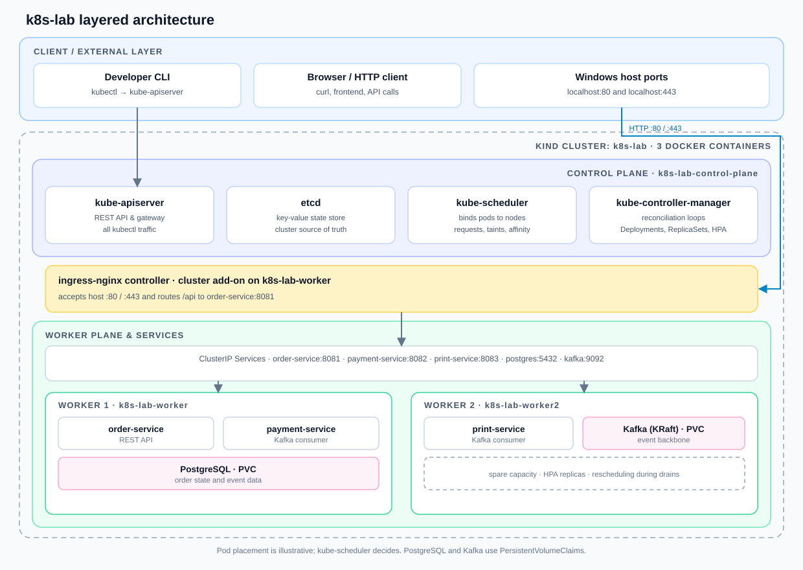

# Kubernetes & Microservices Learning Lab

A hands-on learning lab for Kubernetes and event-driven microservices. It builds a small order platform with **Java 17**, **Spring Boot 3**, **Apache Kafka (KRaft mode)**, **PostgreSQL**, and **Kubernetes (`kind` on Docker Desktop)**, so each concept is practiced against a real, running system rather than an isolated manifest.

## 🎯 Project Goal

Learn Kubernetes in depth — Deployments, Services, ConfigMaps/Secrets, StatefulSets and storage, probes, Ingress, autoscaling, and day-two operations — while seeing how a small set of microservices is designed, containerized, and deployed. Kubernetes is the main focus; the services are real, maintained workloads that make every cluster lesson testable.

## 🏗️ Architecture Overview



The lab is organized into three layers:

### 1. Client / External Layer
- **Developer CLI:** `kubectl` authenticates against the control plane and sends every create, read, and watch request to `kube-apiserver`.
- **Browser / HTTP:** application traffic reaches the Windows host on ports **80** and **443**, which `kind` maps into the cluster and hands to the Ingress controller.

### 2. Control Plane
The control plane (`k8s-lab-control-plane`) owns cluster state:
- **`kube-apiserver`** — the only component clients talk to; it validates and persists requests.
- **`etcd`** — the consistent key-value store that holds all cluster state.
- **`kube-scheduler`** — assigns new pods to nodes based on requests, taints, and affinity.
- **`kube-controller-manager`** — runs reconciliation loops that drive Deployments, ReplicaSets, and autoscaling toward the declared state.

### 3. Worker Plane & Services
The two worker nodes (`k8s-lab-worker`, `k8s-lab-worker2`) run the application workloads, Ingress, and stateful data:
- **Application pods:** `order-service`, `payment-service`, and `print-service`, reached through ClusterIP Services and coordinated by Kafka events.
- **Cluster add-on:** `ingress-nginx` runs on the first worker, where `kind` maps host ports 80/443, and routes external HTTP traffic to the API service.
- **Stateful data:** PostgreSQL and Kafka run with PersistentVolumeClaims, so data survives pod restarts.
- The control-plane taint keeps workloads off the master, matching the usual production pattern of running ingress controllers on worker nodes. Pod placement in the diagram is illustrative — `kube-scheduler` decides.

### Event Flow

```text
[Client / Ingress]
       │ HTTP (REST)
       ▼
┌──────────────┐   order.placed    ┌─────────────────┐   payment.processed   ┌───────────────┐
│ OrderService │ ────────────────► │ PaymentService  │ ────────────────────► │ PrintService  │
└──────┬───────┘                   └────────┬────────┘                       └───────────────┘
       │ JDBC                               │ (Optional status update)
       ▼                                    ▼
┌──────────────┐                   ┌─────────────────┐
│  PostgreSQL  │ ◄─────────────────┤  order.updated  │
└──────────────┘                   └─────────────────┘
```

## 🧩 Microservices & Responsibilities

1. **`order-service` (Port 8081):**
   * Exposes REST APIs to browse product catalog, manage shopping cart items, and submit orders (`POST /api/orders`).
   * Persists catalog, carts, and order state (`PENDING_PAYMENT`, `PAID`, `PAYMENT_FAILED`, `PRINTED`) in PostgreSQL.
   * Publishes `OrderPlacedEvent` to Kafka topic `order.placed` through a transactional outbox written in the same PostgreSQL transaction as the order.
   * Listens to `payment.processed` and `print.completed` to update order lifecycle status.
2. **`payment-service` (Port 8082):**
   * Consumes `order.placed` events. The decision is deterministic and `order-service` applies each state transition exactly once, so duplicate deliveries are safe.
   * Simulates payment authorization and publishes `PaymentProcessedEvent` (`SUCCEEDED` / `FAILED`) to `payment.processed`.
3. **`print-service` (Port 8083):**
   * Consumes `payment.processed` (only when status is `SUCCEEDED`).
   * Formats and logs a fulfillment/receipt ticket, then publishes `PrintCompletedEvent` to `print.completed`.

## 🛠️ Tech Stack
* **Language & Build:** Java 17, Maven (Multi-module)
* **Framework:** Spring Boot 3.3+, Spring Web, Spring Data JPA, Spring Kafka, Spring Boot Actuator
* **Messaging & Storage:** Apache Kafka (KRaft, no ZooKeeper), PostgreSQL 16
* **Container & Orchestration:** Docker Desktop (Linux engine), `kind` (1 control-plane + 2 worker nodes), NGINX Ingress Controller, `kubectl`
* **Packaging & CI:** Helm 3, GitHub Actions
* **GitOps:** Argo CD

## 🚀 Quick Start (Local Kubernetes)

### Prerequisites
- Windows 11 with Docker Desktop (Linux engine)
- PowerShell 5.1+
- Java 17+ and Maven 3.9+
- `kubectl` (bundled with Docker Desktop)
- `kind` (installed by the bootstrap script if missing)

The setup script is PowerShell only; no Python environment is needed.

### Setup & Run

These commands assume Modules 1–4 are complete.

1. **Bootstrap the cluster & install NGINX Ingress:**
   ```powershell
   .\scripts\bootstrap-kind.ps1
   ```
   The script installs `kind` if needed, creates `k8s-lab`, installs ingress-nginx, and waits for the controller to become ready. Manual equivalent:
   ```bash
   kind create cluster --name k8s-lab --config infra/kind-config.yaml
   kubectl apply -f https://raw.githubusercontent.com/kubernetes/ingress-nginx/main/deploy/static/provider/kind/deploy.yaml
   kubectl patch deployment ingress-nginx-controller -n ingress-nginx --type=merge -p '{"spec":{"template":{"spec":{"nodeSelector":{"ingress-ready":"true"}}}}}'
   kubectl wait --namespace ingress-nginx --for=condition=ready pod --selector=app.kubernetes.io/component=controller --timeout=180s
   ```

2. **Build JARs & Docker images:**
   ```bash
   mvn clean package -DskipTests
   docker build -f order-service/Dockerfile -t order-service:0.1.0 .
   docker build -f payment-service/Dockerfile -t payment-service:0.1.0 .
   docker build -f print-service/Dockerfile -t print-service:0.1.0 .
   docker build -f frontend-web/Dockerfile -t frontend-web:0.1.0 .
   ```

3. **Load images into `kind` & deploy manifests:**
   ```bash
   kind load docker-image order-service:0.1.0 payment-service:0.1.0 print-service:0.1.0 frontend-web:0.1.0 --name k8s-lab
   kubectl apply -f infra/k8s/namespace.yaml
   kubectl apply -f infra/k8s/
   ```

4. **Test End-to-End Flow:**
   Open `http://localhost/` for the UI, or use the API:

   ```bash
   # Browse products
   curl -s http://localhost/api/products | jq

   # Add item to cart & place order
   curl -X POST http://localhost/api/carts/user-1/items -H "Content-Type: application/json" -d '{"productId": 1, "quantity": 2}'
   curl -X POST http://localhost/api/orders -H "Content-Type: application/json" -d '{"userId": "user-1"}'
   ```

## 🧰 Cluster Lifecycle

The three kind nodes are Docker containers. Stop them when you want the CPU/memory back:

```powershell
docker stop k8s-lab-worker k8s-lab-worker2 k8s-lab-control-plane
```

Start them again:

```powershell
docker start k8s-lab-control-plane k8s-lab-worker k8s-lab-worker2
kubectl wait --for=condition=Ready node --all --timeout=180s
kubectl get pods -n ingress-nginx
```

The node containers use restart policy `on-failure`, so restarting Docker Desktop does not restart them automatically — run the `docker start` command afterwards.

Reset to a clean cluster (this deletes all pods and persistent data):

```powershell
.\scripts\bootstrap-kind.ps1 -Recreate
```

To remove the cluster entirely: `kind delete cluster --name k8s-lab`.

## 🗺️ Learning Roadmap

This project is organized as a series of modules. Module 0 sets up the cluster; Module 1 establishes the reactor and shared contracts; Modules 2–4 deliver the platform incrementally to Kubernetes; Modules 5–8 cover resilience, packaging, CI, and GitOps. Each module has a prompt and a verification step in [PLAN.md](PLAN.md). Work through them in order, run the verification, and commit before moving to the next one.

- [x] **Module 0**: Environment Bootstrap & Baseline Verification → [docs/module-00-setup.md](docs/module-00-setup.md)
- [x] **Module 1**: Multi-Module Maven Skeleton & Shared Event Contracts → [docs/module-01-common-events.md](docs/module-01-common-events.md)
- [x] **Module 2**: PostgreSQL, Order Service & the First Deployable Slice → [docs/module-02-order-service.md](docs/module-02-order-service.md)
- [x] **Module 3**: Kafka, Payment & Print Service → [docs/module-03-payment-print-service.md](docs/module-03-payment-print-service.md)
- [ ] **Module 4**: React Frontend & Ingress → [PLAN.md](PLAN.md#module-4)
- [ ] **Module 5**: Resilience, Autoscaling & Interview Drills → [PLAN.md](PLAN.md#module-5)
- [ ] **Module 6**: Helm Packaging & Release Lifecycle → [PLAN.md](PLAN.md#module-6)
- [ ] **Module 7**: CI Pipeline (GitHub Actions) → [PLAN.md](PLAN.md#module-7)
- [ ] **Module 8**: GitOps with Argo CD → [PLAN.md](PLAN.md#module-8)
